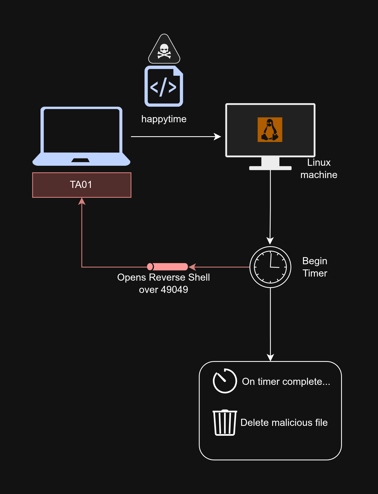

# Live Branch
This branch contains malicious code for a TCP reverse shell that will self-delete after 30 seconds.
written as a proof of concept of how this would work. Designed for linux.

## How it works:

Essentially: this just opens a reverse TCP shell over `49049` and then once 30 seconds passes,
the binary deletes. Nothing special (right now)
